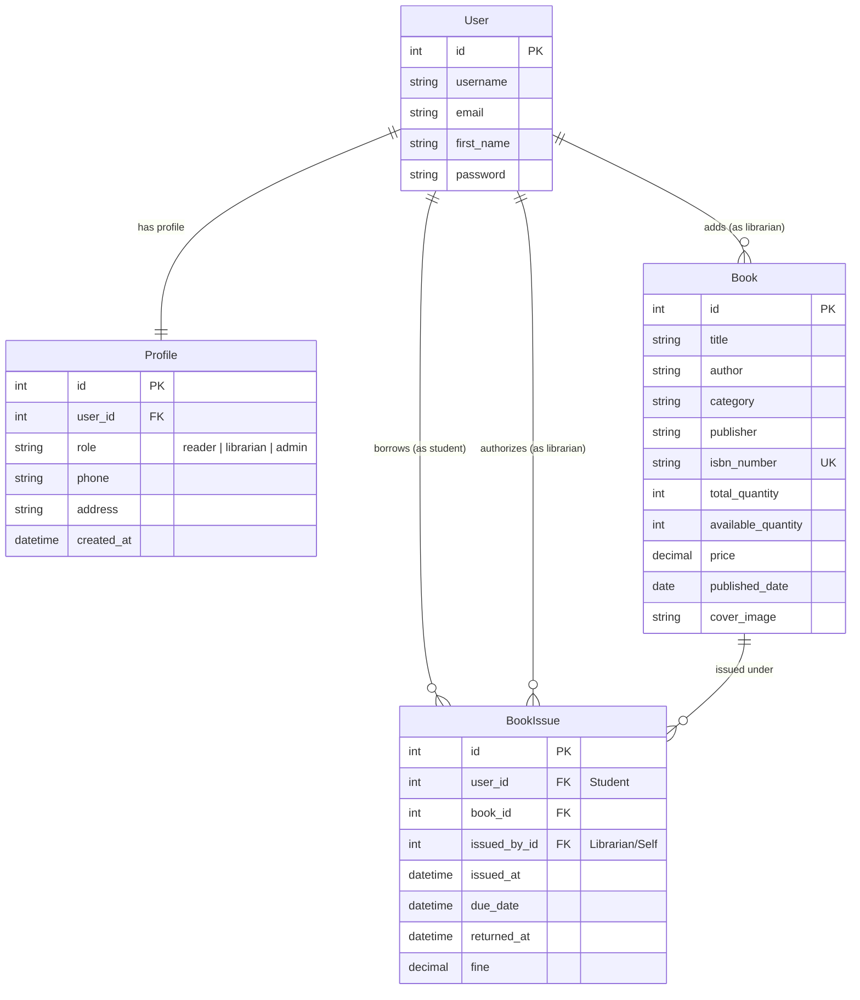
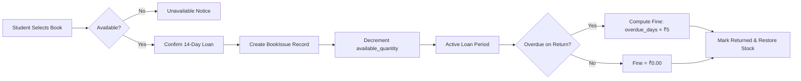

<div align="center">

# 📖 BookVault

### *A Modern, Role-Aware Library Management System*

> *"Your Library, Organized Like a Thoughtful Mind."*

<p align="center">
  <a href="https://github.com/AshrajSingh/BookVault">
    
  </a>
  <a href="https://github.com/AshrajSingh/BookVault">
    
  </a>
  <a href="https://github.com/AshrajSingh/BookVault">
    
  </a>
  <a href="LICENSE">
    
  </a>
  <a href="https://github.com/AshrajSingh/BookVault/stargazers">
    
  </a>
</p>

<p align="center">
  <a href="#-overview">Overview</a> •
  <a href="#-key-features">Key Features</a> •
  <a href="#-visual-tour--screenshots">Visual Tour</a> •
  <a href="#-system-architecture">Architecture</a> •
  <a href="#-tech-stack">Tech Stack</a> •
  <a href="#-quick-start">Quick Start</a> •
  <a href="#-url-routes">Routes</a> •
  <a href="#-roadmap">Roadmap</a>
</p>

---


</div>

---

## 🌟 Overview

**BookVault** is a full-featured web application designed to bring order, clarity, and elegance to institutional and personal library operations. Built with **Django** and powered by a warm, editorial aesthetic, BookVault bridges the gap between readers and administrators through dedicated dashboards, automated inventory tracking, and dynamic fine calculation.

Whether you are a student looking to borrow your next read or a librarian tracking hundreds of active loans, BookVault streamlines the entire lifecycle from cataloging to checkout and returns.

---

## 🚀 Key Features

### 🎓 For Readers / Students
- **Personalized Student Dashboard**: Instant visibility into active loans, pending fines, and books due for return.
- **Interactive Book Catalog**: Explore available books with cover images, category filters, author bios, and live availability badges.
- **Detailed Book Overviews**: Comprehensive information including ISBN-13, publisher, publication date, page count, language, and book summaries.
- **1-Click Loan Confirmation**: Streamlined checkout system with automatic 14-day loan period calculation.
- **Seamless Returns**: One-click book return flow with instant inventory replenishment.
- **Dynamic Fine Tracking**: Transparent breakdown of late fees with due-date warnings.
- **Personal Activity Feed**: Chronological log of all borrowed and returned books.

### 📚 For Librarians & Administrators
- **Executive Operations Dashboard**: High-level KPIs displaying total books in catalog, books currently in circulation, and aggregate outstanding fines.
- **Inventory & Book Management**: Add new volumes with comprehensive metadata validation (ISBN uniqueness check, page count, price, stock quantity, cover uploads).
- **Issue & Overdue Tracking**: Real-time table of all issued books, borrower identity, issuance timestamp, and return status.
- **Automated Fine Calculation Engine**: Dynamic daily fine assessment (`₹5/day` by default, fully configurable) with intelligent status markers (`Overdue` vs `Warning (< 3 days)`).
- **Live Audit Stream**: Real-time activity log tracking issues, returns, and inventory additions with user attribution.

### 🔐 Authentication & Design
- **Animated 3D Flip Card Authentication**: Fluid switch between login and signup within a single interactive card.
- **Intelligent Role-Based Redirection**: Users are routed straight to their designated dashboard (`/studentDashboard` vs `/librarianDashboard`) upon logging in.
- **Warm Editorial UI**: Bespoke color palette (warm beiges, deep espressos, clean paper whites) paired with serif typography (`Playfair Display`) and modern sans-serif body text (`Inter`).

---

## 📸 Visual Tour & Screenshots

> [!TIP]
> *Place your application screenshots in the `docs/screenshots/` directory using the filenames below to showcase your live interface.*

<div align="center">

### 1. Landing Page & Hero Section
*A welcoming, literature-inspired introduction to BookVault.*
<br>

```
┌────────────────────────────────────────────────────────────────────────┐
│                                                                        │
│                    [ SCREENSHOT: Landing Page ]                       │
│                     docs/screenshots/landing-page.png                  │
│                                                                        │
└────────────────────────────────────────────────────────────────────────┘
```
<!-- Once you take a screenshot, uncomment the line below: -->
<!--  -->

---

### 2. Student & Reader Dashboard
*At-a-glance metrics for borrowed books, due dates, fines, and available inventory.*
<br>

```
┌────────────────────────────────────────────────────────────────────────┐
│                                                                        │
│                [ SCREENSHOT: Student Dashboard ]                      │
│                docs/screenshots/student-dashboard.png                  │
│                                                                        │
└────────────────────────────────────────────────────────────────────────┘
```
<!--  -->

---

### 3. Librarian Command Center & KPIs
*Live operational statistics, active issues ledger, and system activity stream.*
<br>

```
┌────────────────────────────────────────────────────────────────────────┐
│                                                                        │
│               [ SCREENSHOT: Librarian Dashboard ]                     │
│               docs/screenshots/librarian-dashboard.png                 │
│                                                                        │
└────────────────────────────────────────────────────────────────────────┘
```
<!--  -->

---

### 4. Book Catalog & Detail View
*Rich book metadata view with author information, availability status, and issuance trigger.*
<br>

```
┌────────────────────────────────────────────────────────────────────────┐
│                                                                        │
│                   [ SCREENSHOT: Book Details ]                         │
│                   docs/screenshots/book-details.png                    │
│                                                                        │
└────────────────────────────────────────────────────────────────────────┘
```
<!--  -->

---

### 5. Overdue & Fine Management Ledger
*Real-time student fine tracker with automated calculations and status alerts.*
<br>

```
┌────────────────────────────────────────────────────────────────────────┐
│                                                                        │
│                  [ SCREENSHOT: Pending Fines ]                         │
│                  docs/screenshots/pending-fines.png                    │
│                                                                        │
└────────────────────────────────────────────────────────────────────────┘
```
<!--  -->

---

### 6. Interactive 3D Flip Authentication
*Sleek, responsive authentication card flipping smoothly between Log In and Sign Up.*
<br>

```
┌────────────────────────────────────────────────────────────────────────┐
│                                                                        │
│                  [ SCREENSHOT: Auth Flip Card ]                        │
│                  docs/screenshots/login-signup.png                     │
│                                                                        │
└────────────────────────────────────────────────────────────────────────┘
```
<!--  -->

</div>

---

## 🏗️ System Architecture

### 📊 Entity-Relationship Diagram



### 🔄 Book Lending & Return Lifecycle



---

## 💻 Tech Stack

| Component | Technology | Description |
| :--- | :--- | :--- |
| **Backend** | Python 3.10+ / Django 5.x / 6.0 | Robust MTV architecture, ORM, and authentication |
| **Database** | SQLite3 | Default lightweight database, readily pluggable with PostgreSQL/MySQL |
| **Media Handling** | Pillow (PIL) | Dynamic book cover image processing and storage |
| **Frontend** | HTML5, CSS3, Vanilla JS | Lightweight, dependency-free UI with custom CSS variables |
| **Typography** | Google Fonts | `Playfair Display` (editorial serif) & `Inter` (clean UI body) |
| **Iconography** | Custom Assets & Unicode | Responsive visual cues and activity badges |

---

## 📁 Repository Structure

```
BookVault/
├── .github/
│   └── ISSUE_TEMPLATE/
│       ├── bug_report.md             # Standardized bug reporting template
│       └── feature_request.md        # Feature suggestion template
├── docs/
│   └── screenshots/
│       └── README.md                 # Guide for adding screenshots
├── bookVault/                        # Main Django Project Root
│   ├── manage.py                     # Django management script
│   ├── requirements.txt              # Project dependencies
│   ├── .gitignore                    # Git ignore file for Python/Django
│   ├── Books/                        # Core Library Application
│   │   ├── migrations/               # Database migration files
│   │   ├── static/                   # Static assets
│   │   │   ├── assets/               # Branding graphics, icons & backgrounds
│   │   │   └── css/                  # 11 Modular CSS stylesheets
│   │   ├── templates/                # 17 Custom HTML templates
│   │   │   ├── homePage.html         # Landing hero page
│   │   │   ├── login.html            # Flip-card authentication
│   │   │   ├── studentDashboard.html # Student portal
│   │   │   ├── librarianDashboard.html# Librarian portal
│   │   │   ├── totalBooksList.html   # Complete inventory list
│   │   │   ├── addBook.html          # New book entry form
│   │   │   ├── bookDetailsPage.html  # Book detail view
│   │   │   ├── confirmIssueBook.html # Loan checkout screen
│   │   │   ├── pendingFines.html     # Overdue & fine management
│   │   │   ├── returnBookList.html   # Book return portal
│   │   │   └── ...
│   │   ├── models.py                 # Book, Profile, and BookIssue models
│   │   ├── views.py                  # Controller logic & route handlers
│   │   ├── urls.py                   # App routing configuration
│   │   └── admin.py                  # Django admin configuration
│   └── bookVault/                    # Project Configuration Directory
│       ├── settings.py               # Application settings & fine configuration
│       ├── urls.py                   # Root URL routing
│       ├── asgi.py                   # ASGI config
│       └── wsgi.py                   # WSGI config
├── .gitignore                        # Root git ignore
├── CONTRIBUTING.md                   # Contribution guidelines
├── LICENSE                           # MIT License
├── README.md                         # Project documentation
└── requirements.txt                  # Root requirements file
```

---

## ⚡ Quick Start & Installation

Follow these steps to get **BookVault** running locally on your machine.

### 1. Prerequisites
- Python 3.10 or higher installed:
  ```bash
  python --version
  ```
- Git installed on your system.

### 2. Clone the Repository
```bash
git clone https://github.com/AshrajSingh/BookVault.git
cd BookVault
```

### 3. Create & Activate a Virtual Environment
```bash
# On macOS / Linux:
python3 -m venv venv
source venv/bin/activate

# On Windows (PowerShell):
python -m venv venv
.\venv\Scripts\Activate.ps1

# On Windows (Command Prompt):
python -m venv venv
.\venv\Scripts\activate.bat
```

### 4. Install Dependencies
```bash
pip install -r requirements.txt
```

### 5. Apply Database Migrations
Navigate into the `bookVault` project folder (where `manage.py` resides):
```bash
cd bookVault
python manage.py migrate
```

### 6. Create a Superuser / Admin (Optional)
```bash
python manage.py createsuperuser
```
Follow the prompts to enter a username, email, and password.

### 7. Run the Development Server
```bash
python manage.py runserver
```

Open your browser and navigate to:
```
http://127.0.0.1:8000/
```

---

## 🎭 Testing User Roles

BookVault features tailored experiences based on user roles. You can test both roles in your local instance:

### Option A: Create a Reader (Student) Account
1. Open `http://127.0.0.1:8000/loginPage/`.
2. Click **Create One** to flip the card to the signup form.
3. Fill in your name, email, password, and select **Reader** under Role.
4. You will be automatically redirected to the **Student Dashboard** (`/studentDashboard/`).
5. Browse books, click **Issue Book**, verify the 14-day loan, and check your return list!

### Option B: Create a Librarian Account
1. Open `http://127.0.0.1:8000/loginPage/`.
2. Flip to the signup form, fill in details, and select **Librarian** under Role.
3. You will be redirected to the **Librarian Dashboard** (`/librarianDashboard/`).
4. Click **Add Book** to stock new books into the catalog with ISBN, cover images, and quantity.
5. Track student borrowings, monitor active loans, and inspect dynamic fine calculations.

---

## 🗺️ Application Route Reference

| URL Path | Method | Description | Access |
| :--- | :--- | :--- | :--- |
| `/` or `/homePage/` | `GET` | Landing page & hero showcase | Public |
| `/contactPage/` | `GET` | Contact & inquiry page | Public |
| `/loginPage/` | `GET` | 3D Flip Login & Sign Up page | Public |
| `/authLogin/` | `POST` | Authenticates user & redirects by role | Public |
| `/authSignup/` | `POST` | Registers new user & profile | Public |
| `/studentDashboard/` | `GET` | Student metrics & available catalog | Reader |
| `/studentDashboard/studentBooksIssued/` | `GET` | List of books borrowed by current student | Reader |
| `/studentDashboard/bookDetailsPage/<id>/` | `GET` | Comprehensive book details page | Reader |
| `/confirmIssueBook/<id>/` | `GET` | Issue preview & 14-day loan confirmation | Reader |
| `/processIssueBook/<id>/` | `POST` | Processes book loan & decrements stock | Reader |
| `/studentDashboard/returnBookList/` | `GET` | Book return management interface | Reader |
| `/returnBook/<id>/` | `POST` | Marks book returned & updates stock/fines | Reader |
| `/studentDashboard/pendingFines/` | `GET` | Student personal fine overview | Reader |
| `/librarianDashboard/` | `GET` | Librarian operational command center | Librarian |
| `/librarianDashboard/booksLists/` | `GET` | Complete library catalog & stock metrics | Librarian |
| `/librarianDashboard/addBook/` | `GET, POST` | Form to register new books into inventory | Librarian |
| `/librarianDashboard/booksIssued/` | `GET` | Detailed log of all books currently out on loan | Librarian |
| `/librarianDashboard/pendingFines/` | `GET` | Overdue monitoring & fine ledger per student | Librarian |
| `/librarianDashboard/bookIssueRequests/` | `GET` | Book issuance request queue | Librarian |
| `/profilePage/` | `GET` | User profile page | Authenticated |

---

## ⚙️ Configuration & Customization

Key parameters can be configured directly in `bookVault/bookVault/settings.py`:

```python
# Rate charged per day for overdue books (in Currency units, e.g. INR ₹)
FINE_PER_DAY = 5

# Media configuration for book cover image uploads
MEDIA_URL = '/media/'
MEDIA_ROOT = BASE_DIR / 'media'

# Standard issue duration (customizable in views.py)
# Default is 14 days: timedelta(days=14)
```

---

## 🔮 Roadmap & Future Enhancements

- [ ] **Automated Email Reminders**: Send warning notifications 2 days prior to the due date.
- [ ] **Barcode & ISBN Scanner**: Allow librarians to scan books for instant check-in / check-out.
- [ ] **Online Fine Settlement**: Integrate Razorpay / Stripe for student fine payments.
- [ ] **E-Book Content Viewer**: Support PDF preview for digital editions alongside physical copies.
- [ ] **Exportable Reports**: Download library activity and fine audits as CSV / PDF.

---

## 🤝 Contributing

Contributions make the open-source community an incredible place to learn, inspire, and create. Any contributions you make are **greatly appreciated**.

Please review our **[Contributing Guidelines](CONTRIBUTING.md)** for details on code style, branching, and submitting pull requests.

1. Fork the Project
2. Create your Feature Branch (`git checkout -b feature/AmazingFeature`)
3. Commit your Changes (`git commit -m 'feat: add amazing feature'`)
4. Push to the Branch (`git push origin feature/AmazingFeature`)
5. Open a Pull Request

---

## 📄 License

Distributed under the **MIT License**. See [`LICENSE`](LICENSE) for more information.

---

## 👨‍💻 Author & Acknowledgements

Created with ❤️ by **[Ashraj Singh](https://github.com/AshrajSingh)**.

- GitHub: [@AshrajSingh](https://github.com/AshrajSingh)
- Project Repository: [https://github.com/AshrajSingh/BookVault](https://github.com/AshrajSingh/BookVault)

<div align="center">
  <sub>⭐ If you find BookVault helpful, consider starring the repository! ⭐</sub>
</div>
